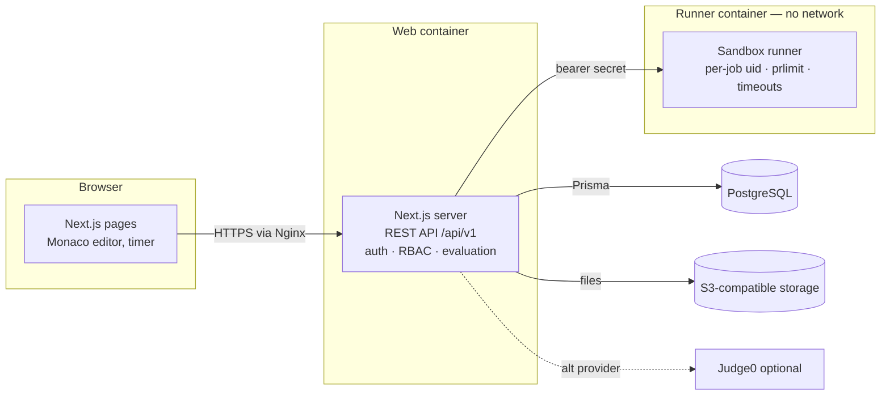

# JECRC VLab — Architecture (Phase 1)

## 1. Reference analysis (vlab.co.in, CSE broad area)

The national Virtual Labs portal is a **directory**: a flat, alphabetical list of labs, each hosted by a
different institute on its own sub-site, with per-lab pages for aim, theory, procedure, simulation and
pre/post tests. There is no shared login, no scheduling, no marks, and no institutional reporting.

What JECRC VLab keeps (the learning model, not the code or content): experiment-centred learning with
theory → procedure → hands-on → self-check. What it adds: one university login, credit-based lab
tracking, timed practicals with server-side timing, automatic + faculty evaluation, projects, results,
rankings and audit. No source, text, images or UI were copied.

## 2. Decisions

| Concern | Choice | Why |
|---|---|---|
| Web app | **Next.js 15 (App Router) + React 19 + TypeScript** | One deployable for UI + REST API; server components read the DB directly with the same auth helpers the API uses. |
| Styling | Tailwind CSS 3 + in-repo shadcn-style components | No runtime UI dependency; JECRC red/black theme via CSS variables; light/dark. |
| DB | **PostgreSQL 16 + Prisma 6** | Relational integrity for academic records, migrations, typed queries. |
| Auth | **Own session auth** (opaque random token in httpOnly SameSite=Lax cookie; SHA-256 of token stored in `AuthSession`), bcrypt (cost 12), lockout after 5 failures | Revocable server sessions, no JWT pitfalls; SSO (SAML/OIDC) can be added as another login method that calls `createSession`. |
| Authorization | Role matrix (`src/lib/rbac.ts`) + ownership checks (`canManageSubject`, `canManageOffering`), enforced in every API route through `route()` | Every endpoint must declare roles/permission; ownership is checked in the handler. |
| Code execution | **Separate sandbox runner service** (`services/runner`) behind an `ExecutionProvider` interface; **Judge0** provider also included | Student code never runs in the web-app process. See §5. |
| Editor | Monaco (`@monaco-editor/react`), bundled locally (no CDN) | Professional editor, syntax highlighting, formatting. |
| Charts | Recharts | Lightweight, React-native. |
| Exports | ExcelJS (xlsx), PDFKit (pdf), CSV | Server-side generation. |
| Diagrams | Mermaid source stored per experiment, rendered client-side, editable with live preview | Faculty can create/modify flowcharts without a drawing tool; images can also be attached. |
| Storage | `local` driver for dev, `s3` (any S3-compatible) for production | Project files and experiment resources. |
| Deploy | Docker Compose: `web`, `runner`, `postgres`, `nginx` (TLS) | Runner is isolated in its own container with no network. |

## 3. System context



## 4. Module map

| Module | Server code | Pages |
|---|---|---|
| Auth & sessions | `lib/auth.ts`, `api/v1/auth/*` | `/login` |
| RBAC | `lib/rbac.ts`, `lib/api.ts` | — |
| Labs & experiments | `api/v1/subjects`, `api/v1/experiments` | `/labs`, `/labs/[slug]`, `/experiments/[id]` |
| Compiler | `lib/execution/*`, `api/v1/run` | `/compiler`, editor in experiment & practical pages |
| Practicals (timed) | `lib/timer.ts`, `api/v1/sessions/*` | `/practicals`, `/practicals/[id]` |
| Evaluation & marks | `lib/evaluation.ts`, `lib/services/submissions.ts`, `api/v1/submissions/*` | `/faculty/review` |
| Projects | `api/v1/projects/*` | `/projects` |
| Results & ranking | `lib/grading.ts`, `lib/services/results.ts`, `api/v1/results/*` | `/results`, `/reports` |
| Admin | `api/v1/admin/*` | `/admin/*` |
| Notifications & audit | `lib/notify.ts`, `lib/audit.ts` | `/notifications`, `/admin/audit` |

## 5. Code-execution security

* Runs in a **separate service/container**; the web app only sends source + inputs over HTTP with a shared bearer secret (constant-time compared).
* Per job: fresh temp dir; each concurrency slot uses a **distinct unprivileged uid**; `setpriv --no-new-privs --clear-groups --inh-caps=-all`; `prlimit` CPU seconds, address space, file size (1 MB), open files, processes; `unshare -n` (no network) when available; wall-clock kill of the whole process group; leftover processes of the slot uid reaped after each job; output capped (64 KB default).
* Container hardening (compose): `network_mode: none` for the runner's execution network, read-only root FS, tmpfs work dir, `pids_limit`, CPU and memory limits, dropped capabilities except those needed for `setpriv`/`unshare`, default seccomp.
* Queue with bounded length → HTTP 429 instead of overload; per-user run rate limit in the web app.
* Hidden test inputs/expected outputs are never sent to students; reference solutions are stripped unless faculty enables `showSolution` outside assessments.
* Verified by `tests/runner.smoke.ts`: infinite loop → TLE, memory bomb → MLE, output flood → OLE, network blocked, cannot write outside job dir, non-root uid, fork bomb contained, runner healthy afterwards.

## 6. Timer integrity

`PracticalSession.startedAt/endsAt` are set from **server time** when faculty starts the session.
A student's deadline = `endsAt + Σ extensions + user.extraTimeMinutes`. Submissions are validated on the
server with a 15 s network grace; late submissions are rejected unless faculty enabled late submission (then flagged `isLate`).
Clients receive `serverNow` and `deadline` and render a countdown from the offset, so changing the
device clock has no effect. Drafts autosave every 15 s and on blur/unload; refresh resumes from the last draft.

## 7. Assessment model

Default rubric (per experiment, configurable): correctness 40, logic 20, quality 10, efficiency 10, compilation 10, submission 10.

* **Automatic**: correctness (weighted share of public + hidden tests), compilation/execution (full / half if runtime errors / zero on compile error), submission (full on time, half late).
* **Faculty only**: logic, code quality, efficiency (execution time shown as evidence), plus correctness for experiments without automatic tests (web, written).
* Overrides require a reason and create `MarkOverride` + `AuditLog` rows. Students see marks only after `marksReleaseAt`.

## 8. Results

Final score = weighted mix (policy, default experiments 55 · project 25 · viva 10 · attendance 10).
Experiment average divides by the **required** count (missing practicals count as zero). Outcome: DETAINED below the
attendance threshold, FAIL below pass %, INCOMPLETE while practicals/project are outstanding, else PASS.
Ranking uses competition ranking ("1-2-2-4") with the policy's tie-break keys; ties are shown as ties.
Results stay DRAFT until finalized by faculty/HOD/admin (audited); finalized offerings are locked from recomputation.

## 9. Folder structure

```
jecrc-vlab/
├─ prisma/                 schema.prisma, migrations/, seed.ts, seed-data/ (catalog + full experiments)
├─ services/runner/        sandbox runner (server.ts, sandbox.ts, languages.ts, vrun.c, sqlrun.py)
├─ src/
│  ├─ app/
│  │  ├─ (public)          landing, login
│  │  ├─ (app)/            authenticated pages (student, faculty, admin, labs, compiler, practicals …)
│  │  └─ api/v1/           REST API route handlers
│  ├─ components/          ui/ (design system), shell/, editor/, charts/, feature components
│  └─ lib/                 auth, rbac, api, evaluation, timer, grading, execution/, services/, settings
├─ tests/                  vitest unit tests, runner security smoke test, content verification
├─ docker/                 Dockerfiles, nginx config
└─ docs/                   architecture, ER diagram, API, deployment, testing
```

## 10. Risks & dependencies

| Risk | Mitigation |
|---|---|
| Sandbox escape / DoS from student code | Separate container, no network, per-slot uid, rlimits, queue limits; option to use Judge0 (isolate-based). Treat runner hosts as untrusted. |
| Exam-day load (hundreds of simultaneous runs) | Runner scales horizontally (stateless); queue + 429; per-user rate limits; size runner pool for ~1 run/student/minute. |
| Network loss during practicals | Autosave + local draft cache; server deadline + grace; faculty extensions. |
| Subjective marks automated wrongly | Only objective components are auto-scored; others stay pending until faculty review. |
| Content volume (14 labs × 40+) | 46 fully written experiments shipped; remaining 514 seeded as **draft outlines** with CSV/Excel bulk import for faculty to complete. |
| Branding/legal | Uses JECRC University logo supplied by the project owner; branding is configurable in settings. |
| Docker Hub rate limits in CI | Pin images; mirror base images in a private registry. |
