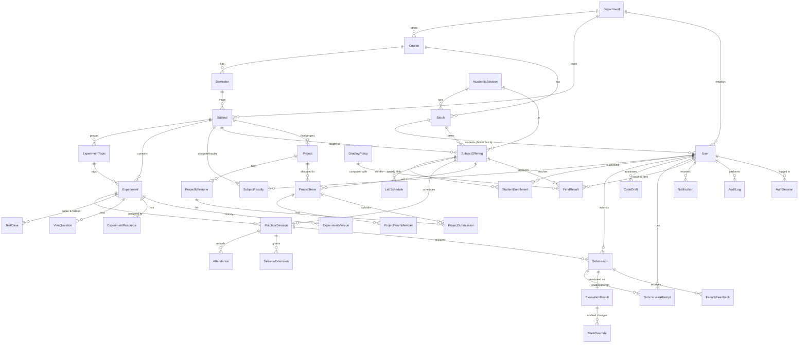

# Entity-relationship diagram

Primary keys are `id` (cuid) unless noted; composite keys are marked. Full constraints and indexes are in `prisma/schema.prisma`.

## Key constraints

| Table | Unique / constraint | Purpose |
|---|---|---|
| User | email, enrollmentNo, employeeId | One account per person |
| Experiment | (subjectId, number), code | Stable experiment numbering per lab |
| SubjectOffering | (subjectId, batchId, academicSessionId) | One class per lab/batch/term |
| StudentEnrollment | (offeringId, studentId) | No duplicate enrollment |
| PracticalSession | (offeringId, sequence) | Practical #1..N per class |
| Attendance | (sessionId, studentId) | One record per student per practical |
| Submission | (studentId, sessionId) | **One graded submission per practical** (practice submissions have no session) |
| EvaluationResult | submissionId | One evaluation per submission |
| CodeDraft | (studentId, experimentId, language) | Autosave slot |
| FinalResult | (offeringId, studentId) | One result per student per class |
| ProjectTeamMember | (teamId, studentId) PK | Team membership |
| SubjectFaculty | (subjectId, userId) PK | Faculty assignment |

Indexes cover role/department lookups, experiment filtering (subject, difficulty, status), attempt history
(student, experiment), sessions by status/date, notifications by (user, read), audit by entity/actor/date.
